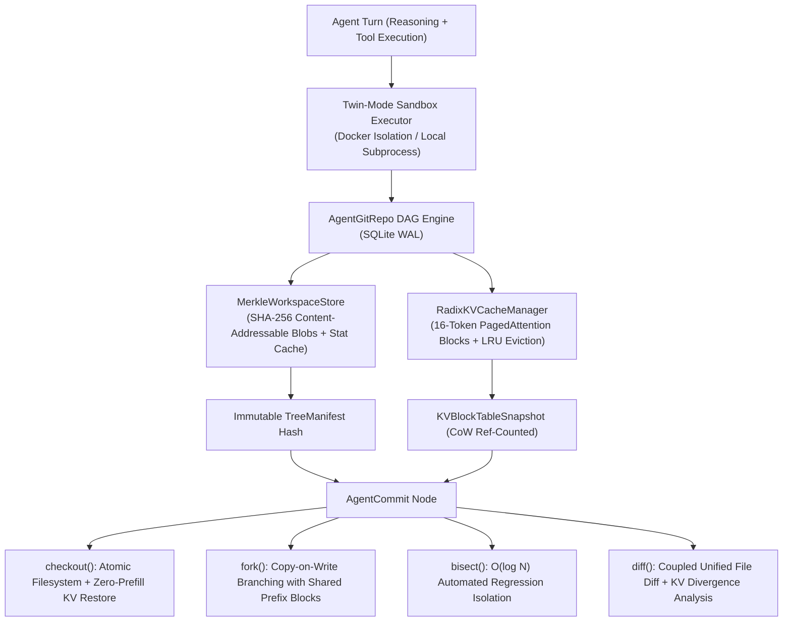

# AgentGit

[](https://github.com/arman1o1/AgentGit/actions/workflows/ci.yml)

**AgentGit** is a deterministic time-travel debugging, trajectory-forking, and automated bisection runtime for autonomous multi-turn coding and tool-using LLM agents. When a long-horizon coding agent fails mid-trajectory, AgentGit eliminates full-trajectory reruns and prompt prefill recomputation by atomically snapshotting both the **sandbox filesystem state** and the **PagedAttention Radix KV-cache block table** at every agent step.

---

## System Architecture



| Subsystem | Module / Class | Mechanism | Verified Performance |
| :--- | :--- | :--- | :--- |
| **Merkle CoW Filesystem Store** | `MerkleWorkspaceStore`, `TreeManifest`, `FileEntry` | SHA-256 content-addressable blob store with `zlib` compression, `(path, mtime_ns, size)` stat caching for $O(1)$ incremental snapshots, and binary-safe unified diffs. | `4.25 ms` mean snapshot latency; `579.1x` storage deduplication ratio |
| **Paged Radix KV-Cache Manager** | `RadixKVCacheManager`, `KVPhysicalBlock`, `KVBlockTableSnapshot` | Fixed-size (`16`-token) PagedAttention blocks with cryptographic prefix-hash chaining (`SHA256(parent_hash \|\| token_ids)`), Copy-on-Write (`ref_count`) block sharing, automatic LRU disk eviction under memory budgets, and HuggingFace `past_key_values` zero-copy bridge. | `98.3%` prefix cache hit rate on forks; `94.6%` physical KV memory reduction |
| **Time-Travel DAG & Sandbox** | `AgentGitRepo`, `CodingAgentSandboxTools`, `TokenizerBridge` | SQLite WAL transactional commit graph with twin-mode Docker/local sandbox isolation, path-traversal protection, and pluggable tokenizers (`bpe_regex`, `tiktoken`, `huggingface`, `deterministic`). | `3 probes (402.9 ms)` to isolate a Step #5 regression across a 10-step trajectory |
| **Interactive Visual Studio** | `agentgit_debugger.html`, `run_http_server` | Standalone visual DAG explorer, Paged KV-block reference inspector, side-by-side Merkle + KV diff viewer, interactive `bisect` stepper, and live `fork` studio served over REST. | Embedded REST API (`GET /api/commits`, `POST /api/fork`, `POST /api/checkout`) |

---

## Project Structure

```text
AgentGit/
├── .github/
│   └── workflows/
│       └── ci.yml              # GitHub Actions CI pipeline (Python 3.11, built-in suite + pytest)
├── tests/
│   └── test_agentgit.py        # Pytest unit and integration suite (DAG, bisect, LRU KV eviction, HF bridge, security)
├── agentgit.py                 # Core engine: Merkle CoW store, Radix KV manager, SQLite DAG, CLI, and REST server
├── agentgit_debugger.html      # Interactive Time-Travel Debugger Studio (standalone + live REST client)
├── Dockerfile                  # Containerized runtime image
├── pyproject.toml              # Project metadata, optional LLM dependencies, and pytest configuration
├── requirements.txt            # Core runtime dependencies
└── LICENSE                     # MIT License
```

---

## Setup and Installation

### 1. Clone the Repository

```bash
git clone https://github.com/arman1o1/AgentGit
cd AgentGit
```

### 2. Setup Virtual Environment and Install Dependencies

Using `pip`:

```bash
python -m venv .venv
source .venv/bin/activate  # On Windows: .venv\Scripts\activate
pip install -r requirements.txt
pip install pytest
```

Or using `uv`:

```bash
uv venv
uv pip install -r requirements.txt pytest
```

---

## Running the Application

### 1. End-to-End Debugging Simulation (`demo`)

Executes a 10-step coding agent trajectory where the agent introduces a floating-point rounding regression at Step #5, automatically isolates the culprit commit in $O(\log N)$ probes via `agentgit bisect`, and branches from Step #4 via `agentgit fork` with zero prefill recomputation:

```bash
python agentgit.py demo
```

### 2. Quantitative Performance Benchmarks (`benchmark`)

Runs a 32-commit, 5-branch benchmark measuring incremental Merkle snapshot latency, Paged KV-cache prefix hit rates, Copy-on-Write memory savings, and cold-block disk offload/hydration throughput:

```bash
python agentgit.py benchmark
```

### 3. Interactive Visual Studio & REST Server (`serve`)

Launches the embedded HTTP server serving both the interactive **AgentGit Studio** web interface and JSON API endpoints:

```bash
python agentgit.py serve --port 8765
```

Open `http://127.0.0.1:8765` in your browser to inspect the commit DAG, Paged KV-cache block tables, coupled diffs, and interactive bisection probes, or open `agentgit_debugger.html` directly as a standalone file.

---

## Testing

Run the built-in 10-stage verification suite:

```bash
python agentgit.py test
```

Or run the full `pytest` suite:

```bash
pytest -v
```

---

## License

This project is licensed under the MIT License. See the [LICENSE](LICENSE) file for details.
